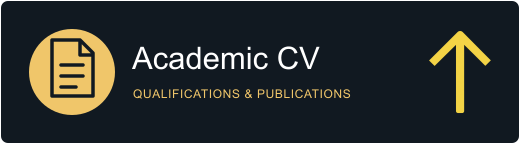
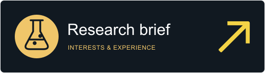
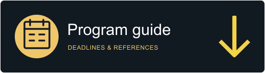
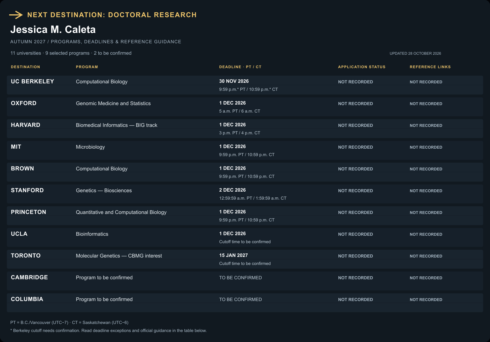

# Jessica M. Caleta · PhD referee package

**[Click the flight board to open the full program table, clickable university links, deadlines, and recommendation-letter guidance →](Program_Info.md)**

Welcome, and thank you for supporting my autumn 2027 PhD applications. This page is the central reference for my program choices, deadlines, and application progress. The Program Info table links to the best official recommendation-letter guidance available; applicant-facing pages are labeled. Application status does not indicate whether a recommendation letter has been submitted.

Updating the board

Edit the **Application status** and **Recommendation letter link** columns in [Program_Info.md](Program_Info.md), then commit the change to `main`. For recommendation letter links, use only “Sent”, “Not sent”, or “Not recorded”. You can also update program choices, deadlines, and notes in the same file, including the date at the top.

GitHub Actions refreshes this landing page and its board after each edit. To regenerate locally, run `uv run python scripts/render_board.py` followed by `uv run --with pillow python scripts/render_animation.py`. The full table in Program Info preserves the exact status wording and all guidance links.

